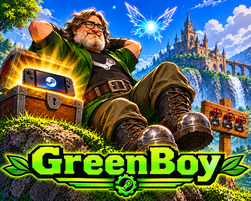

<h1 align="center">
  
   <b>GreenBoy</b> 
</h1>

<h4 align="center">A native PC build of your own copy of the game. No emulator. Tuned and measured on the Steam Deck.</h4>

## What this is

A static recompilation, built from your own copy of the game: the game's code is translated to C and
compiled into a native program, the console's system software is reimplemented, and its graphics API is
rebuilt on Vulkan. Nothing in this repository, and nothing in its releases, contains the game, its keys,
its executable, or anything made from its assets.

## What is in a release

| file | what it is |
|---|---|
| `Hookshot-*-x86_64.AppImage` | the builder: builds the game from your copy on your machine |
| `hookshot_vk.so` | the Vulkan renderer the build uses |
| `deck-settings.env` | the settings this hardware was measured with |
| `SHA256SUMS` | checksums for the above |

## Settings, and why these values

- `RX_VK_CHUNK=500` — the recording is cut every 500 draws instead of 120. At 120 the frame re-sent all of
  its state about 21 times; this was worth 14.60 → 12.87 ms of replay time in a matched test.
- `RX_VK_FRAMEGEN=0` — frame generation at 2× cost 8.5 ms of GPU time a frame here and doubled shadows.
- `RX_VK_CHECKPOINTS=0` — it writes a GPU marker before every draw and dispatch, about 2,300 a frame.
  Diagnostic only.
- `HOS_SHORT_SLEEP_TIMER=1` — the game's idle job workers wait on a timer instead of spinning (each was
  taking 13–26 % of a processor).
- `HOS_SPIN_US=20` — the kernel-call spin before a contended lock sleeps. At 1 µs the frame was 45.25 →
  44.74 ms; at 20 µs, 45.25 → 36.23 ms.

## Measured

At a matched scene of 707 draws a frame, same machine, same settings, one binary apart:

| | replay | whole frame | fps |
|---|---|---|---|
| before | 19.19 ms | 45.25 ms | 22.1 |
| this build | 12.87 ms | 35.46 ms | 28.2 |

The frame is CPU-bound on this hardware: 4.0–4.4 cores of work for 4 cores, with the GPU idle at
5.8–12.9 ms of it.

## Security

The update check is **off unless you set `HOOKSHOT_CHECK_UPSTREAM=1`**. Earlier versions checked a
repository that no longer exists and whose name can be re-registered by anyone — see `SECURITY-AUDIT.md`
for what was found and changed. `HOOKSHOT_NO_UPDATE_CHECK=1` also works.

## Licence

Free software, GPL-3.0. The renderer links Eden's and suyu's code and is published with its source for that
reason. Upstream's MIT notices are kept where they apply. The licence text is in `LICENSE`.

This is an unofficial project. It is not affiliated with, endorsed by or associated with the rights holders
of the game it builds; all game code, assets and trademarks belong to them.
